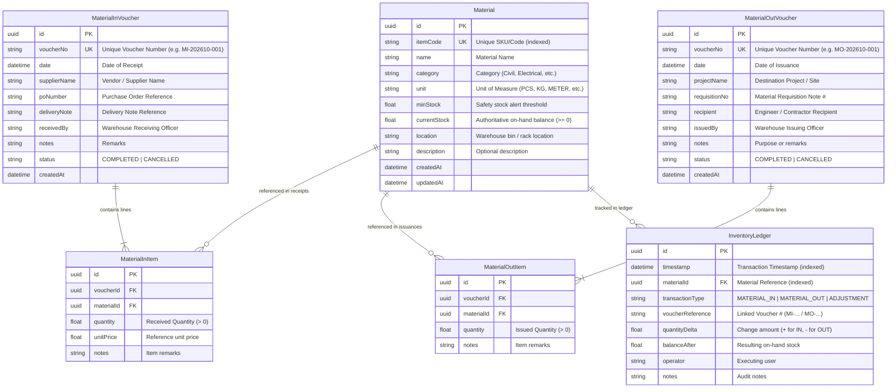

# Data Model Specification: Contracting Warehouse ERP

**Feature**: [spec.md](spec.md) | **Branch**: `001-contracting-warehouse-erp` | **Date**: 2026-10-29

## Overview
This document specifies the PostgreSQL relational data model, entity relationships, integrity constraints, and state transitions for the Contracting Warehouse ERP.

---

## Entity Relationship Diagram

---

## Entity Details & Validation Rules

### 1. `Material`
* **Constraints**:
  * `itemCode`: Required, Unique, Uppercase alphanumeric (`^[A-Z0-9_-]+$`).
  * `name`: Required, min 2 characters, max 150 characters.
  * `category`: Required (e.g., `Civil`, `Piping`, `Electrical`, `Mechanical`, `Safety`, `Tools`).
  * `unit`: Required (e.g., `PCS`, `KG`, `METER`, `BAG`, `BOX`, `DRUM`, `LITER`).
  * `minStock`: Required, `>= 0`, default `0`.
  * `currentStock`: Required, check constraint `currentStock >= 0`.
* **State & Derived Logic**:
  * `isLowStock`: Virtual boolean derived when `currentStock <= minStock`.

### 2. `MaterialInVoucher` & `MaterialInItem`
* **Constraints**:
  * `voucherNo`: Generated automatically or unique user input (`MI-YYYYMM-XXXX`).
  * `date`: Required date (cannot be in the far future).
  * `supplierName`: Required, non-empty.
  * `poNumber` / `deliveryNote`: At least one reference document required.
  * `items`: Must contain at least 1 line item.
  * `quantity`: Required, strictly `> 0`.

### 3. `MaterialOutVoucher` & `MaterialOutItem`
* **Constraints**:
  * `voucherNo`: Generated automatically or unique user input (`MO-YYYYMM-XXXX`).
  * `date`: Required date.
  * `projectName`: Required, non-empty.
  * `recipient`: Required, non-empty.
  * `items`: Must contain at least 1 line item.
  * `quantity`: Required, strictly `> 0`, and `<= currentStock` of the target material.

### 4. `InventoryLedger` (Immutable Audit Log)
* **Constraints**:
  * Read-only table: Records can only be inserted via atomic database transactions during voucher processing.
  * `quantityDelta`:
    * If `transactionType == 'MATERIAL_IN'`, `quantityDelta > 0`.
    * If `transactionType == 'MATERIAL_OUT'`, `quantityDelta < 0`.
  * `balanceAfter`: Reflects the exact `Material.currentStock` immediately following the transaction.

---

## Transactional State Transitions

### Material In Intake Flow
1. User submits Material In form via React Hook Form + Zod.
2. Server opens PostgreSQL transaction (`prisma.$transaction`):
   * Insert `MaterialInVoucher` and nested `MaterialInItem` records.
   * For each line item:
     * Increment `Material.currentStock` by `item.quantity`.
     * Insert `InventoryLedger` with delta `+item.quantity` and resulting balance.
3. Transaction commits; triggers toast notification and path revalidation.

### Material Out Issuance Flow
1. User submits Material Out form.
2. Server opens PostgreSQL transaction (`prisma.$transaction`):
   * Verify all requested materials have `currentStock >= requestedQuantity`. If any fails, rollback and throw an `InsufficientStockError`.
   * Insert `MaterialOutVoucher` and nested `MaterialOutItem` records.
   * For each line item:
     * Decrement `Material.currentStock` conditionally: `WHERE id = $id AND currentStock >= $qty`.
     * Insert `InventoryLedger` with delta `-item.quantity` and resulting balance.
3. Transaction commits; triggers toast notification and path revalidation.

