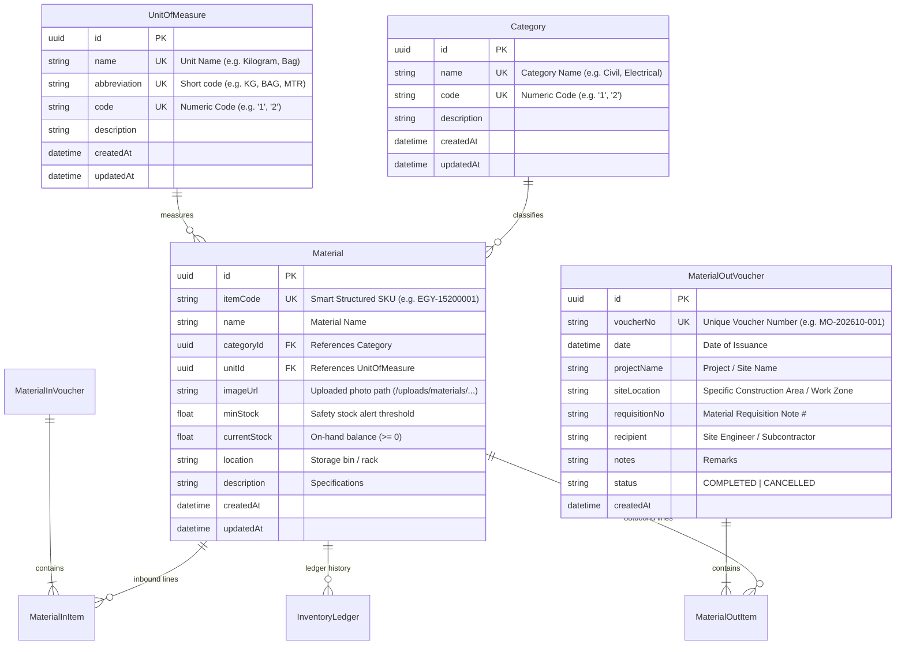

# Data Model Specification: Advanced ERP Enhancements

**Feature**: [spec.md](spec.md) | **Branch**: `002-warehouse-erp-enhancements` | **Date**: 2026-10-29

## Overview
This document specifies the enhanced PostgreSQL schema incorporating relational `Category` and `UnitOfMeasure` entities, image storage references on `Material`, and refined construction site location fields on `MaterialOutVoucher`.

---

## Entity Relationship Diagram

---

## Field Specifications & Validation Rules

### 1. `Category`
* `name`: Required, 2-100 characters, Unique.
* `code`: Required, numeric string `1-99`, Unique (used as category digit in smart SKU).
* `description`: Optional text.
* **Deletion Rule**: RESTRICT deletion if referenced by existing `Material` records.

### 2. `UnitOfMeasure`
* `name`: Required, 2-100 characters, Unique.
* `abbreviation`: Required, 1-15 uppercase characters (e.g., `KG`, `BAG`, `MTR`, `PCS`), Unique.
* `code`: Required, numeric string `1-99`, Unique (used as unit digit in smart SKU).
* `description`: Optional text.
* **Deletion Rule**: RESTRICT deletion if referenced by existing `Material` records.

### 3. `Material` (Updated)
* `itemCode`: Required, Unique, formatted as `^[A-Z]{3}-[0-9]{3,4}[0-9]{4,6}$` (e.g., `EGY-15200001`).
* `categoryId`: Required UUID foreign key to `Category`.
* `unitId`: Required UUID foreign key to `UnitOfMeasure`.
* `imageUrl`: Optional string path (e.g., `/uploads/materials/mat-xyz.webp`).
* `currentStock`: Float `>= 0`.
* `minStock`: Float `>= 0`.

### 4. `MaterialOutVoucher` (Updated)
* `issuedBy`: Removed.
* `siteLocation`: Required string, 2-150 characters, capturing the specific job site construction zone (e.g., "Kiln Preheater Tower - Level 4", "Foundation Pouring Bay 2").
* `recipient`: Required string, 2-100 characters.

